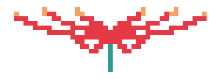

<p align="center">
  
</p>

<h2 align="center">radiata</h2>

<p align="center">
  <strong>A minimal, multi-provider, token-efficient coding and orchestration harness.</strong><br/>
  Forked from <a href="https://github.com/PrimeIntellect-ai/prime-agent">PrimeIntellect-ai/prime-agent</a> (MIT License).
</p>

---

**radiata** is a personal Rust/Python fork of [Prime Agent](https://github.com/PrimeIntellect-ai/prime-agent) built around Prime Agent's [Recursive Language Model (RLM)](https://www.primeintellect.ai/blog/rlm) Python kernel and [Continual Harness](https://arxiv.org/abs/2605.09998), extended to unify my favorite multi-agent workflows into one terminal-first harness without juggling separate apps, orchestrators, and code-review tools.

## What radiata Adds Over Upstream Prime Agent

- **Unified Multi-Provider Streaming:** Run native API models alongside CLI-backed agents from one daemon and TUI — **Antigravity (`agy acp`)** with live chain-of-thought and tool telemetry + `session/load` resume, **Cursor (`cursor-agent`)**, official **Claude Code CLI (`claude`)**, **Codex**, and **Prime Inference** — with resume-safe prompt caching across providers.
- **Persistent Project Captains (`F6` / `F7`):** Durable SQLite WAL (`synchronous=FULL`) project orchestration with a 4-tab hub (`Overview`, `Digest`, `Drive`, `Factories`), `F7` crew switcher, selectable bottom dock, human-readable run naming, live drill-in directly into active factory step subagents, mid-turn steering (`Enter` steer / `Alt+Enter` server-side queue) + image attachments, 1-key structured escalation cards, spend/token budgets, cron schedules, GitHub PR/CI watches, and inline diff review triage (`o`/`r`/`i` + `R` rollback).
- **Compiled Finite-State Machine (FSM) Factories:** Typed `machine.toml` v1 pipelines with a 3-choice onboarding flow, interactive visual chart composer, deterministic Python gates (`validate`, `sanitize-diff`) before frontier models, cross-family adversarial `review-triad` (Claude + Codex + Gemini), error-signature anti-spin breakers, and dual output binding (`rlm.factory.emit` for native RLM models; fenced `` ```factory-outputs `` JSON / emit-file extraction for CLI-backed agents).
- **Decoupled Code Approval vs. Live Model Policy:** Approval covers code and control flow via SHA-256 snapshots frozen at dispatch (eliminating TOCTOU races), while model and thinking-level overrides live in a SQLite model overlay — letting you or the Captain hot-swap models across every FSM stage live without invalidating approved digests or disturbing in-flight runs.
- **Untracked-Safe Isolated Git Worktrees:** Writer tasks fork from temporary `GIT_INDEX_FILE` snapshots (`refs/pa/bases/`, excluding `.prime/`) and record pre-turn checkpoints (`refs/pa/checkpoints/`) so uncommitted repositories fork and roll back cleanly without mutating your branch.
- **Aggressive Token & Prompt-Cache Hygiene:**
  - **Orchestrator delta prompts (−92% hidden context per turn):** Monotonic `reports.rowid` delta cursors, SHA-cached static prefixes (including auth-filtered configured models), compact 1-line crew indexes, pointer-based `.prime/captain/reports/` & `handoffs/`, per-event wake policies (`react` / `context` / `ignore`), and debounce coalescing.
  - **3-layer Context Absorption (`/absorb`):** Instead of switching back into bloated external chat transcripts, stay in a fresh chat and absorb context from previous **Prime, Claude, Codex, Cursor, Antigravity, or T3/Flock** chats as a content-addressed, prompt-cache-safe ~1.5k-token packet with a 10 ms live git freshness check and an on-demand indexed `transcript.md` pointer (~65× cheaper than raw replay).

## Build & Install

Requires Rust (stable) and Python 3 (`uv` for `prime-agent-runtime` tests):

```bash
git clone https://github.com/zh1kang/prime-agent.git
cd prime-agent
cargo build --locked -p radiata-cli

# Install locally (retains `pa` / `prime-agent` compatibility alongside `radiata`)
mkdir -p ~/.local/share/pa-harness ~/.local/bin
cp target/debug/prime-agent ~/.local/share/pa-harness/prime-agent.new
mv -f ~/.local/share/pa-harness/prime-agent.new ~/.local/share/pa-harness/prime-agent
ln -sf ~/.local/bin/pa ~/.local/bin/radiata
```

You can also use `./install-rust.sh` to build and wire the launcher scripts and `radiata` symlink automatically.

## Getting Started

Launch **radiata** inside any repository:

```bash
cd /path/to/project
radiata
```

On first launch, run `/login` to connect your API keys or local provider CLIs (`claude`, `codex`, `agy`, `cursor-agent`).

> [!WARNING]
> Like upstream Prime Agent, **radiata** executes model-generated Python and project commands with your user permissions. Its worker processes, git worktrees, and SHA-256 factory approvals improve isolation and reviewability, but they are **not** a security sandbox. Review changes and use trusted repositories, instructions, and skills only.

### Everyday Shortcuts & Commands

| Command / Key | Action |
| :--- | :--- |
| `F6` / `/captain` | Open the 4-tab Captain hub (`Overview`, `Digest`, `Drive`, `Factories`) |
| `F7` / `/crew` | Quick crew & live factory step-subagent switcher (`n` new thread, `a` add existing) |
| `Shift+F7` | Jump straight back to the Captain chat |
| `/fsm` | Open the project FSM review & interactive diagram editor |
| `/absorb [query] [--focus …]` | Absorb distilled context from one or more prior chats into the current chat |
| `Ctrl+L` / `/model` | Floating model + thinking-level picker |
| `Alt+A` | Expand/focus the bottom activity dock |
| `radiata --resume [id]` | Resume a native session |
| `radiata thread connections` | Check connected CLI/API providers |
| `radiata thread absorb <provider> <path>` | Generate a cached context packet from the CLI |
| `radiata thread captain status` | Inspect Captain projects, crew, usage, and schedules as JSON |

See [docs/captain-design.md](docs/captain-design.md), [docs/provider-threads.md](docs/provider-threads.md), and [skills/captain/references/fsm-design-guide.md](skills/captain/references/fsm-design-guide.md) for architecture and FSM authoring details.

## Upstream Attribution & License

**radiata** is a fork of [PrimeIntellect-ai/prime-agent](https://github.com/PrimeIntellect-ai/prime-agent) and remains open source under the [MIT License](LICENSE).

If you use this codebase in research, please cite upstream Prime Agent:

```bibtex
@article{karten2026prime,
  title={Prime Agent: A Self-Improving RLM Harness},
  author={Karten, Seth and Zhang, Alex L. and Thomas, Kevin and Müller, Sebastian and Bakouch, Elie and Auras, Daniel and Senghaas, Mika and Obeid, Fares and Dunas, Konstantin and Hagemann, Johannes and Jaghouar, Sami},
  journal={arXiv preprint arXiv:2608.23552},
  year={2026}
}
```

Available at [https://arxiv.org/abs/2608.23552](https://arxiv.org/abs/2608.23552).
